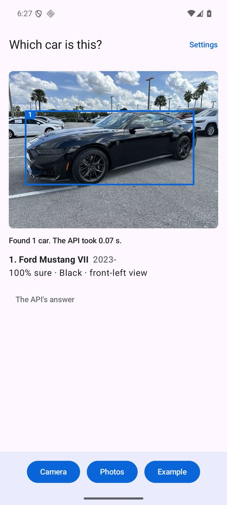

# Android app

An Android app that takes a photo of a car, or picks one from the gallery, and shows which car it is, with a box around each car. Written in Kotlin with Jetpack Compose. Apart from Compose, it uses only what Android includes: no networking or image libraries.



## What it does

1. You take a photo (**Camera**), choose one (**Photos**), or tap **Example**.
2. The app shrinks the photo to at most 2,048 pixels on the long side and turns it upright (see [Photo size](#photo-size)).
3. It sends the photo to the API and shows the answer: the make, model and generation with production years, how sure the recognition is, the body color, the angle, close alternatives, and the API's full answer.

The photo sent is a new JPEG made from the pixels only, so it carries no location or camera details.

## What you need

- **Android Studio**, a recent version. It brings the Android SDK and a JDK. The app compiles against Android SDK 37; Android Studio offers to install it when you open the project.
- **A phone with Android 8.0 or later**, or an emulator. The emulator's camera shows a virtual room, not a car: use **Photos** or **Example** there.
- **A CarNET API key.** Get a free trial key (300 requests) at [carnet.ai](https://carnet.ai/#pricing-block). You don't need a key for CarNET Server or for your own server (see [Settings](#settings)).

## Run it

1. In Android Studio, open the `android` folder.
2. Choose an emulator or a connected phone, and press Run.
3. In the app, tap **Settings** (top right), paste your API key and tap **Done**.
4. Tap **Example**.

To add your own photos to the emulator, drag them onto its window: they go to its Downloads folder, which **Photos** can open.

On a phone, turn on USB debugging first: **Settings → About phone**, tap **Build number** seven times, then **Developer options → USB debugging**.

### From the command line

With JDK 17 or later in `JAVA_HOME` and the Android SDK in `ANDROID_HOME`:

```sh
cd android
./gradlew assembleDebug
adb install app/build/outputs/apk/debug/app-debug.apk
```

## Settings

| Setting | What to put there |
|---|---|
| **API key** | Your CarNET API key. It's kept in the app's private storage and left out of cloud backups. Leave it empty for CarNET Server or your own server. |
| **API address** | The Cloud API: `https://api.carnet.ai/v2/mmg/detect` (the default). [CarNET Server](https://carnet.ai/on-premise): `http://YOUR-SERVER:50052/detect`. Your own server: its address, such as the micro website's `https://YOUR-SITE/api/recognize`. |

CarNET Server speaks plain HTTP on your own network, so the app allows plain HTTP (`android:usesCleartextTraffic` in `AndroidManifest.xml`). Remove that line if you only use HTTPS.

## Before you publish an app

- **Don't put your API key in the app.** Anyone can take a key out of an app and spend its requests. Send photos to your own server, which adds the key. The [micro website](../web/)'s server does exactly that: point the API address at `https://YOUR-SITE/api/recognize` and leave the key empty. It answers in the same format, so the app needs no other change.
- **Replace the Settings screen** with your own server's fixed address.
- **Change `applicationId`** in `app/build.gradle.kts` to your own.
- **Build a signed release:** in Android Studio, **Build → Generate Signed App Bundle or APK**.
- **Google Play's Data safety form:** say that photos are sent to your server for recognition.

## Photo size

The app shrinks photos to at most 2,048 pixels on the long side before sending them. That's about a quarter of a phone photo's upload, so answers come back sooner on mobile data.

In our check with 15 phone photos, the answers the API was sure about stayed the same as for the full photo. Two things can change:

- Cars far away in the photo may be skipped. The API leaves out cars less than 180 pixels wide in the photo it receives, and shrinking makes every car smaller.
- An answer the API was unsure about at full size may change.

To send larger photos, raise `LONG_SIDE` in `PhotoShrinker.kt`. The API takes photos up to 12 MB.

## Your key's limits

Each photo is one request. If the key's per-second limit is reached, the app waits for the next second and tries once more. When the daily or monthly limit is used up, it says so and shows when the limit renews.

## The code

In `app/src/main/java/ai/carnet/samples/recognition/`:

| File | What it does |
|---|---|
| `CarnetClient.kt` | Sends a photo to the API and reads the answer or the error. The part to copy into your own app. |
| `PhotoShrinker.kt` | Makes the JPEG that is sent: at most 2,048 pixels, upright, without metadata. |
| `Recognizer.kt` | Runs one recognition and holds what the screen shows. |
| `MainActivity.kt` | The screens: the photo with boxes, the answers, the buttons, and Settings. |
| `Settings.kt` | The two settings. |

## Tests

```sh
./gradlew testDebugUnitTest
```

The tests run the client against a stand-in for the API on your computer, so they send no real requests.
