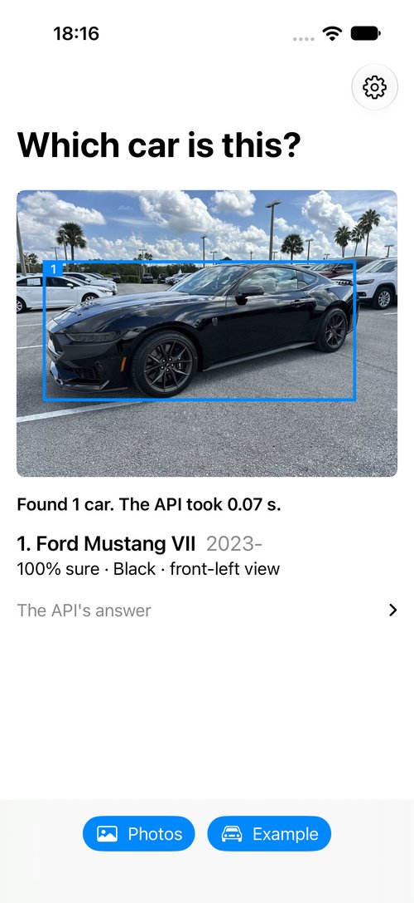

# iOS app

An iPhone app that takes a photo of a car, or picks one from the photo library, and shows which car it is, with a box around each car. Written in Swift and SwiftUI, with no packages to add.



## What it does

1. You take a photo (**Camera**), choose one (**Photos**), or tap **Example**.
2. The app shrinks the photo to at most 2,048 pixels on the long side and turns it upright (see [Photo size](#photo-size)).
3. It sends the photo to the API and shows the answer: the make, model and generation with production years, how sure the recognition is, the body color, the angle, close alternatives, and the API's full answer.

The photo sent is a new JPEG made from the pixels only, so it carries no location or camera details.

## What you need

- **A Mac with Xcode 16 or later.**
- **An iPhone with iOS 17 or later**, or the iOS simulator that comes with Xcode. The simulator has no camera: use **Photos** or **Example** there.
- **A CarNET API key.** Get a free trial key (300 requests) at [carnet.ai](https://carnet.ai/#pricing-block). You don't need a key for CarNET Server or for your own server (see [Settings](#settings)).

## Run it

1. Open `CarRecognition.xcodeproj` in Xcode.
2. Choose a simulator, such as iPhone 17, and press Run (⌘R).
3. In the app, tap **Settings** (top right), paste your API key and tap **Done**.
4. Tap **Example**.

To add your own photos to the simulator, drag them from Finder onto its window.

### On your iPhone

1. In Xcode, select the **CarRecognition** target, open **Signing & Capabilities**, and choose your **Team**.
2. Change the **Bundle Identifier** to one of your own, such as `com.yourcompany.CarRecognition`.
3. Connect the iPhone, choose it as the run destination, and press Run.

The first time, the iPhone asks you to trust the developer: **Settings → General → VPN & Device Management**.

## Settings

| Setting | What to put there |
|---|---|
| **API key** | Your CarNET API key. It's kept in the iPhone's keychain. Leave it empty for CarNET Server or your own server. |
| **API address** | The Cloud API: `https://api.carnet.ai/v2/mmg/detect` (the default). [CarNET Server](https://carnet.ai/on-premise): `http://YOUR-SERVER:50052/detect`. Your own server: its address, such as the micro website's `https://YOUR-SITE/api/recognize`. |

CarNET Server speaks plain HTTP on your own network. The app allows plain HTTP to local addresses only (`NSAllowsLocalNetworking` in `Info.plist`); for a server reached by a public name, put HTTPS in front of it.

## Before you publish an app

- **Don't put your API key in the app.** Anyone can take a key out of an app and spend its requests. Send photos to your own server, which adds the key. The [micro website](../web/)'s server does exactly that: point the API address at `https://YOUR-SITE/api/recognize` and leave the key empty. It answers in the same format, so the app needs no other change.
- **Replace the Settings screen** with your own server's fixed address.
- **App Store privacy details:** say that photos are sent to your server for recognition.

## Photo size

The app shrinks photos to at most 2,048 pixels on the long side before sending them. That's about a quarter of a phone photo's upload, so answers come back sooner on mobile data.

In our check with 15 phone photos, the answers the API was sure about stayed the same as for the full photo. Two things can change:

- Cars far away in the photo may be skipped. The API leaves out cars less than 180 pixels wide in the photo it receives, and shrinking makes every car smaller.
- An answer the API was unsure about at full size may change.

To send larger photos, raise `longSide` in `PhotoShrinker.swift`. The API takes photos up to 12 MB.

## Your key's limits

Each photo is one request. If the key's per-second limit is reached, the app waits for the next second and tries once more. When the daily or monthly limit is used up, it says so and shows when the limit renews.

## The code

| File | What it does |
|---|---|
| `CarnetClient.swift` | Sends a photo to the API and reads the answer or the error. The part to copy into your own app. |
| `PhotoShrinker.swift` | Makes the JPEG that is sent: at most 2,048 pixels, upright, without metadata. |
| `Recognizer.swift` | Runs one recognition and holds what the screen shows. |
| `ContentView.swift` | The screen: the photo with boxes, the answers, the buttons. |
| `SettingsView.swift`, `Settings.swift` | The two settings; the key in the keychain. |
| `CameraPicker.swift` | The system camera. |

## Tests

In Xcode, press ⌘U, or run:

```sh
xcodebuild test -project CarRecognition.xcodeproj -scheme CarRecognition -destination 'platform=iOS Simulator,name=iPhone 17'
```

The tests run the client against a stand-in for the API, so they send no real requests. They also check that a large photo is shrunk and turned upright, and that the photo sent carries no location.

The Xcode project is made from `project.yml` with [XcodeGen](https://github.com/yonaskolb/XcodeGen). You only need XcodeGen if you change `project.yml`.
