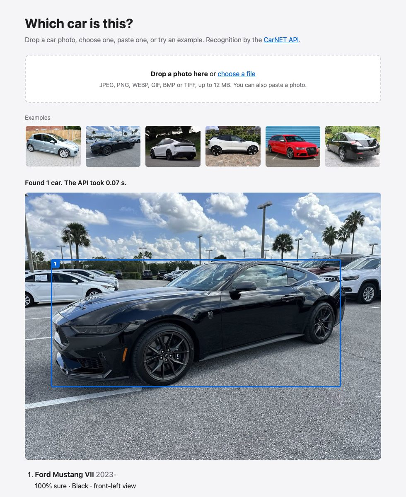

# Micro website

A small website where visitors drop, choose or paste a car photo, or click an example, and see which car it is, with a box around each car. Use it as a starting point for your own page, or to show the API to your team.



## How it works

```text
browser  ── photo ──▶  server.js  ── photo + your key ──▶  CarNET API
         ◀─ answer ──             ◀───── answer ──────────
```

- **The page** (`public/`) takes the photo and shrinks a large one before sending it (see [Photo size](#photo-size)). It then shows the API's answer: the make, model and generation with production years, how sure the recognition is, the body color, the angle, and close alternatives.
- **The server** (`server.js`) adds your API key and sends the photo on to the API. The key never reaches the browser. A page can't call the API directly anyway: the API doesn't take calls made from other sites' pages.

`server.js` is one file with no packages to install.

## What you need

- **Node.js 22 or later.** Check with `node --version`.
- **A CarNET API key.** Get a free trial key (300 requests) at [carnet.ai](https://carnet.ai/#pricing-block). You don't need a key for CarNET Server.

## Run it on your computer

```sh
git clone https://github.com/OneStar-dev/CarNET.ai.samples.git
cd CarNET.ai.samples/web
CARNET_API_KEY=your-key node server.js
```

Open http://localhost:8080 and click an example.

On Windows (PowerShell): `$env:CARNET_API_KEY="your-key"; node server.js`

## Settings

Set these as environment variables:

| Variable | Default | Meaning |
|---|---|---|
| `CARNET_API_KEY` | | Your API key. Not needed for CarNET Server. |
| `CARNET_API_URL` | `https://api.carnet.ai/v2/mmg/detect` | The API's address. For [CarNET Server](https://carnet.ai/on-premise): `http://YOUR-SERVER:50052/detect` |
| `PORT` | `8080` | The port the site listens on |
| `HOST` | `localhost` | Set `0.0.0.0` to take connections from other machines. The Docker image does this. |

## Put it online

**Before you do:** every photo a visitor sends is one request on your key. Anyone who can open the page can use up its requests. Put the page behind a login or keep it on your own network, unless you're happy to share them.

### With Docker

```sh
docker build -t carnet-demo .
docker run -d --restart unless-stopped -e CARNET_API_KEY=your-key -p 8080:8080 carnet-demo
```

### As a service on Linux (systemd)

Copy the `web` folder to `/opt/carnet-demo`, put `CARNET_API_KEY=your-key` in `/etc/carnet-demo.env` (readable by root only: `chmod 600`), and save this as `/etc/systemd/system/carnet-demo.service`:

```ini
[Unit]
Description=Car recognition demo
After=network-online.target

[Service]
WorkingDirectory=/opt/carnet-demo
ExecStart=/usr/bin/node server.js
EnvironmentFile=/etc/carnet-demo.env
User=www-data
Restart=on-failure

[Install]
WantedBy=multi-user.target
```

Then start it: `sudo systemctl enable --now carnet-demo`. Its log: `journalctl -u carnet-demo`.

### Behind nginx

Run the site on the same machine (with Docker or as a service), then pass requests to it from your nginx site, which keeps your HTTPS set-up:

```nginx
location / {
    proxy_pass http://127.0.0.1:8080;
    client_max_body_size 13m;  # photos up to 12 MB
}
```

The page uses relative addresses, so it also works under a path, such as `location /car-demo/ { proxy_pass http://127.0.0.1:8080/; }`.

## Photo size

The page shrinks photos larger than 2,048 pixels on the long side into a JPEG before sending them. That's about a quarter of a phone photo's upload, so answers come back sooner on a slow connection.

In our check with 15 phone photos, the answers the API was sure about stayed the same. Two things can change:

- Cars far away in the photo may be skipped. The API leaves out cars less than 180 pixels wide in the photo it receives, and shrinking makes every car smaller.
- An answer the API was unsure about at full size may change.

To send photos at full size, set `LONG_SIDE` in `public/app.js` to a large number. The API takes photos up to 12 MB.

## Your key's limits

Each photo is one request. When two visitors send photos in the same second and the key allows one a second, the server waits for the next second and sends the second photo then. When the key's daily or monthly limit is used up, visitors see "This site's limit of photos is used up for now."

The server's log shows each request's status, size, time and how many requests the key has left:

```text
2026-11-16T16:44:40.217Z 200, 245931 bytes, 253 ms, 44 requests left
```

## Change it

- **Examples:** put photos in `public/examples` and small copies in `public/examples/thumb`, then list them in `public/index.html`.
- **What the API is asked for:** `QUERY` in `server.js`. For example, add `&region=NA` to use the network trained for North America.
- **Photo size:** `LONG_SIDE` in `public/app.js`.

## Tests

`npm test` runs `server.js` against a stand-in for the API, so it sends no real requests.
